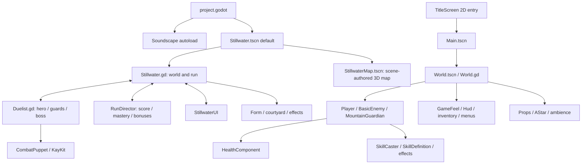

# Kiến trúc tổng thể

[Index](README.md) · [module index](module-index.md) · [data flows](data-flows.md).

## Hai runtime trong một project

`project.godot` boot **Stillwater 3D**, còn Qinglan 2D được giữ với entry riêng. Hai nhánh chia sẻ InputMap project, fonts, AudioServer và Soundscape autoload; không chia sẻ combat model hay run director. Không có C# hoặc lớp service/backend trong source inventory. Stack/binary/export chi tiết: [project runtime](modules/project-runtime.md).

Các mũi tên thể hiện ownership/call reference ở source, không phải dependency injection framework. W/R/U/D trực tiếp đọc/ghi thuộc tính nhau; đây là coupling cần biết khi sửa.

## Lifecycle 3D

Scene default gắn Stillwater.gd và instance `StillwaterMap.tscn`. `_ready()` tạo director -> `setup_map()` lấy environment/camera/light/seals/fireflies và gắn CourtyardAtmosphere -> player/world reference -> UI -> voices/settings/title/checkpoint. Geometry tĩnh đã serialize trong map scene; actors/effects vẫn được tạo lúc chạy. `setup_map()` duplicate Environment theo mỗi world root và phục hồi terminal RNG state cũ để giữ chuỗi random của gameplay. Actor/puppet/effects vẫn cần role/world/actor trước add_child vì `_ready()` chạy trong lúc đưa vào tree.

World `_process` điều phối run/input/spawn/camera; Duelist `_physics_process` giữ combat clocks, control/AI, collision và animation sampling. Menu dừng combat bằng mode; không tree pause. RunDirector RefCounted không có node `_process`, chỉ world.update gọi và actor combat_event ghi stats. UI CanvasLayer poll world/director mỗi frame; button callbacks gọi world API. CourtyardAtmosphere là visual observer độc lập, không advance progression.

3D combat dùng float hp/posture/stamina, action strings và world callbacks. Effects thực hiện projectile/hazard/surge; Form tạo geometry/material. CombatPuppet dùng AnimationPlayer manual sampling trên KayKit imported Skeleton3D; không AnimationTree. Retry tạo toàn bộ root mới bằng deferred call, restore checkpoint Dictionary rồi xóa root cũ.

## Lifecycle 2D

TitleScreen fade/change_scene Main -> World PackedScene. World children gồm player, Enemies/Chests và Hud; `_ready()` của World sau children mới đăng ký group world, random props, AStar, ambience và GameFeel. Player/BasicEnemy dùng HealthComponent child; initial health signals có thể đã emit trước parent connect nên caller đọc current state sau nối. Hud đặt ALWAYS để input/menu vẫn chạy khi tree paused.

World giữ spawn clocks/nav/slam charge. PlayerController giữ movement/combo/stamina/weapon, SkillCaster child giữ slots/cooldowns. BasicEnemy giữ AI/faction/corpse; GameFeel quan sát health để đếm kills, upgrade ở 6/14 và summon boss ở 24. Hud sở hữu bag/equipment; đổi weapon gọi player. Pause/inventory/upgrade dùng SceneTree.paused và meta journey_modal.

## Storage và organization

- Runtime data: `.tres` skills 2D + font wrappers; scene export overrides là dữ liệu cấu hình của actor/props.
- ConfigFile local: stillwater.cfg (3D settings/best), settings.cfg (2D/shared preferences), journey.cfg (2D best kills). Checkpoints/inventory/run không save đĩa.
- Authoring: GDScript/Python/shaders/scenes/resources trong source dirs; artwork raw + derivatives ở assets. `.godot`, output/tmp là generated/local.
- Build: export_presets + allowlisted package_release; không có CI workflow trong `.github` hiện tại. Dependency tools và validation ở [tooling](modules/tooling-release.md), [testing](modules/testing.md).

Không suy gameplay/card deck hiện tồn tại từ input bindings hoặc old plans. Không dùng sơ đồ này để bỏ qua source checks khi task đổi contract.
