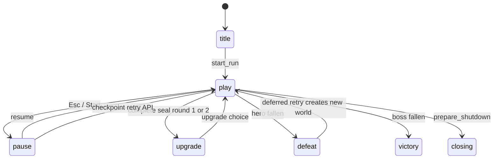

# Luồng dữ liệu và state transitions

[Index](README.md) · chi tiết ownership/API trong [modules](module-index.md).

## 3D: scene boot -> map and runtime

`project.godot` -> `Stillwater.tscn` -> instance `StillwaterMap.tscn` (geometry, camera, environment, key light, rain, fireflies, seal platforms, `CourtyardBackdrop.tscn`) -> `Stillwater._ready/setup_map()` resolves named nodes, duplicates the Environment, attaches `CourtyardAtmosphere`, then builds hero/UI/audio. Map geometry is scene data; combat actors, encounters, and atmosphere observer remain runtime-owned.

## 3D: input -> contact -> feedback

`project.godot` actions + `Stillwater.configure_gamepad/_unhandled_input` -> `Duelist._physics_process/control` buffer/start_attack -> action attack, timer/duration/locked -> contact_fraction khi released=false -> `Stillwater.melee` geometry + ray -> `Duelist.hurt` guard/immunity/difficulty/HP -> `Stillwater.combat_event` -> `RunDirector.record` score/flow/stats. Trúng đòn/defense gọi world flash/burst/audio và `world.ui.feedback.receive_hit/receive_defense`; UI poll health/posture/mastery. Enemy HP=0 -> world.fallen -> kill/victory; hero HP=0 -> defeat.

## 3D: run state

Encounter flags là state bên trong play: `interact` capture checkpoint -> nearest unfinished seal -> spawn_queue -> guards capped bốn living -> queue empty + enemies clear + no valid boss -> complete_seal. Round 1/2 upgrade; round 3 boss + cinematic; director detects half HP -> phase 2 cinematic; boss death victory. Guide là modal_kind, không world mode mới.

Checkpoint Dictionary chỉ chứa tiến trình giữa encounter. Retry snapshot + run_time/retries -> instantiate Stillwater -> `_ready` -> restore -> current_scene mới, root cũ queue_free. Không lưu enemy instances/HP/dead flags, RNG state, cooldown/echo hoặc encounter dở. `RunDirector.restore` phục hồi stats/bonuses/score/flow, không chain timer/surge/cinematic. Xem [run](modules/stillwater-run.md).

Dash -> `leave_echo` snapshot puppet -> `cast(0)` ray thông đường + cost -> damage segment ngay -> recall movement + consume echo. `cast(1)` cone/ray -> hurt/launch -> move_and_slide collision -> `world.crash`. SpiritBolt hostile group -> timed guard hoặc PressureWave/StillnessBurst gọi `SpiritBolt.reflect()` -> bỏ hostile group -> damage enemy. Surge flow full -> activate_surge -> mở ring, hits khi viền đến -> buff sáu giây.

## 2D: damage, corpse và resurrection

Input -> `PlayerController._try_melee_attack` set delayed attack -> `_resolve_melee_attack` query/ray -> enemy knockback/stagger -> `HealthComponent.take_damage` emits damaged/health_changed/died. BasicEnemy callbacks update visuals/HP/corpse; GameFeel quan sát health để đếm progression. Special combat message emit tối đa một lần/attack, priority impact > counter > back-hit > momentum.

Enemy AI `find_nearest_target` -> World.get_path_direction -> AStar + steering -> windup -> target.handle_enemy_attack (player perfect guard) hoặc target health fallback. Health=0 hostile -> corpses group, bỏ hostile -> flight collision/slam -> settle tắt collider + register nav obstacle -> lifetime/fade -> tree_exiting unregister.

Transform: Player slot 0 -> SkillCaster.try_cast_slot -> TransformSkillEffect.activate context -> radius scan corpses (fire lion loại) -> instance corpse source scene, copy faction/stats trước add_child -> thêm zombie -> xóa corpse -> nav obstacle unregister. Zombie thuộc enemies + zombies, target hostile; chết queue_free ngay, không tạo corpse. Player melee chủ động bỏ group zombies.

## 2D: resource skills và inventory/progression

Resource `resources/skills/*.tres` dùng SkillDefinition -> effect_scene -> `SkillCaster.try_cast_slot()` gọi scene.instantiate/add_child -> activate(context). False => cooldown=0, failure signal, không pay; true/void => pay cost, started signal. Active slot auto retry mỗi 1s; player numbers cast trực tiếp. Defensive orb lưu metadata caster để refresh một instance.

Inventory button -> Hud.bag_items/equipped_items swap -> refresh/glyph -> PlayerController.set_equipped_weapon stats/visual. Armor chỉ metadata slot, talisman/pill chưa có dùng item. M mở inventory lưu prior pause; đóng phục hồi prior pause. Không persistence inventory.

GameFeel health.died callback -> kills 6/14 -> deferred UpgradeChoice (tree paused + journey_modal) -> chosen -> damage/max-health/spawn pressure; kills 24 -> dừng World._process, clear hostile -> MountainGuardian -> boss death result. Victory disable player physics; defeat result không checkpoint system.

## Persistence và global state

| Path / owner | Dữ liệu | Không bao gồm |
| --- | --- | --- |
| user://stillwater.cfg / Stillwater._ready/save_settings | shake, difficulty, sound, best run time | Checkpoint hoặc save run |
| user://settings.cfg / Soundscape, TitleScreen, PauseMenu | accessibility.shake, audio.sound | 3D difficulty |
| user://journey.cfg / GameFeel | best kill count | Items, skills, stage hoặc actor instances |

AudioServer master mute và InputMap là global trong process. 3D settings có thể override mute autoload đã đọc từ settings.cfg. `Soundscape.shutdown` -> prepare_shutdown -> tree pause -> stop audio recursive -> await -> quit. Config load thường có fallback; save errors chưa được report (known issues).
