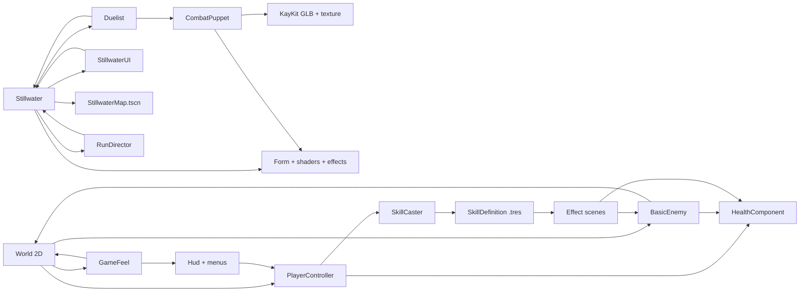

# Dependencies và coupling

[Index](README.md) · [architecture](architecture.md). Source-level direction: caller -> dependency, không ngụ ý import một chiều.

## Internal contracts dễ vỡ

| Contract | Source / consumer | Rủi ro khi đổi |
| --- | --- | --- |
| world/hero/boss/kind trước add_child | Stillwater._ready/spawn_guard/begin_boss -> Duelist._ready -> CombatPuppet._ready | Sai HP, model, weapon, collider hoặc null world |
| action/timer/duration/released/locked | Duelist + Stillwater + CombatPuppet | Contact lệch pose, double hit, bypass pause/cinematic |
| world.mode/director | Actor, projectile, UI, director, effects | Các clocks dừng khác nhau, modal leaks |
| Director dictionary keys | Stillwater upgrades/checkpoint, Duelist regen, StillwaterUI | UI và buff/restore không đồng bộ |
| Named bones/clips/slots | CombatPuppet/RainEcho -> imported KayKit tree | Không có abstract rig adapter hoặc null fallback tổng quát |
| HealthComponent signal order | player/enemy/Hud/GameFeel | Count kill, render HP, death và corpse có thể gọi trong cùng stack |
| Group names | world/player/enemies/hostile_enemies/zombies/corpses/breakables/chests/boss/game_feel | Targeting/spawn cap/revive/nav/UI thay đổi ngầm |
| Node paths | PlayerController, BasicEnemy, Hud, BattleLayout, GameFeel -> scenes | Rename node phá @onready hoặc runtime lookup |
| AStar obstacle counts + tree_exiting | World <-> BasicEnemy corpse/BreakableCrate | Cells stale hoặc xóa obstacle chồng lấn |
| activate(context) boolean/void | SkillCaster -> effect scenes | Cost/cooldown rollback, cleanup và success semantics |
| Weapon ID strings | Hud -> PlayerController -> WeaponRig/ItemGlyph | Bag có thể cập nhật UI mà stats/visual không khớp |
| InputMap + raw keys | project.godot + Stillwater.configure_gamepad + Hud/Title/UI | 1..3, Space, R có nghĩa khác giữa hai nhánh |

`StillwaterMap.tscn` sở hữu geometry/collider/material và instance `CourtyardBackdrop.tscn` cho cảnh xa, lá/mưa/mist; `Stillwater.setup_map()` giữ node-path contract cho camera, environment, key light, ba seal và 35 firefly. `CourtyardDetail.attach_atmosphere()` thêm observer runtime sau khi map refs sẵn sàng.

Dynamic contracts dùng has_method/get/set/meta, không interface type; source-inventory liệt kê symbol và literal res paths nhưng không thay được call tracing. GameFeel còn gọi private World helper và đọc sâu Hud node tree.

## External/build dependencies

| Dependency | Bằng chứng / phạm vi |
| --- | --- |
| Godot 4.x engine, Jolt/Forward Plus | project.godot; local binary 4.7.2; release script bắt 4.6.2 |
| Export templates desktop | package_release gọi --export-release macOS/Windows; template có sẵn chưa kiểm tra |
| KayKit Adventurers GLB/textures | CombatPuppet/RainEcho preloads; source attribution trong THIRD_PARTY_NOTICES |
| Noto Sans/Serif SC | font wrappers và JianghuTheme; OFL notices có trong repo |
| Python standard library | package/test/audio tools, không lockfile |
| Pillow (PIL) | chroma/extract/prepare tools và ba Python test files; chưa có trong interpreter khảo sát |
| pytest | test_extract_idle_sheet.py; chưa có trong interpreter khảo sát |
| FFmpeg (tùy chọn) | docs/DEVELOPMENT.md video conversion; runtime không gọi |

Không tìm thấy addons, dependency vendoring hay `.github/workflows` trong phạm vi khảo sát. Không gọi network/backend ở gameplay source đã đọc. External release URLs chỉ được ghi nhận từ tài liệu, không truy cập/xác nhận trạng thái dịch vụ.
